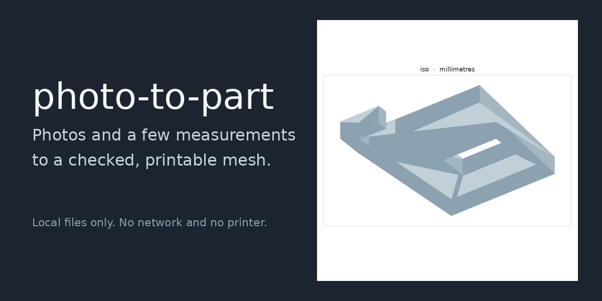
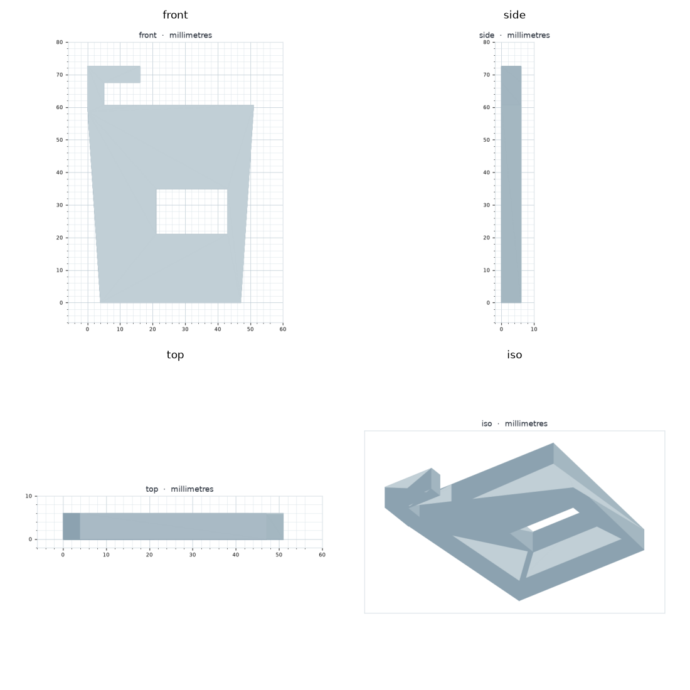
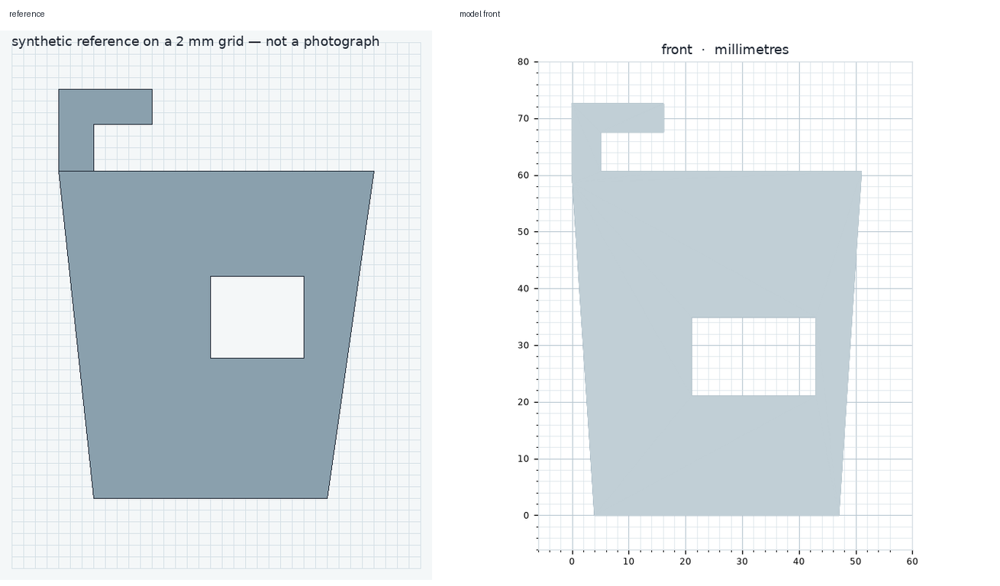

# photo-to-part

Hermes plugin that turns photos, a few measurements, or a messy 3D scan into a parametric part you can print or edit. The agent writes the solid in code, checks that the mesh is watertight and the right size, and renders views you can hold next to the original.

It is a community plugin by [Kyle Durepos](https://github.com/mojomast). It is not a Nous Research product. The method is inspired by Michael Lydick's video [I'm an Engineer. This ChatGPT Test Scared Me.](https://www.youtube.com/watch?v=TUqScwjnO_k) The sample in this repo is a generic plate with a hook, not a copy of the object in that video.



## What you get

One skill and six tools. The skill id is `photo-to-part:photo-to-printable-part`. Load it with `skill_view("photo-to-part:photo-to-printable-part")`. That is the whole id. `plugin:photo-to-part:photo-to-printable-part` is not a skill name. A `plugin:` prefix in Hermes docs is a placeholder, and a skill name cannot contain a colon, so that string is not registered as an alias.

A Hermes session has about 40 tool calls in total (`PHOTO_PART_MAX_CALLS` overrides that cap). Hermes v0.21.7 does not put a call counter on the plugin context. It does pass `session_id`. After this plugin has been used in that session, a `post_tool_call` hook counts every tool call, including terminal commands, and `transform_tool_result` adds one line at 60%, 80%, and 95% of the cap. The used count is also read from `$HERMES_HOME/state.db` and from JSON/JSONL files under `$HERMES_HOME/sessions`. Pass `calls_used` as well. The larger of the hook count, the session count, and `calls_used` wins, and that number is not capped at 40. A session that has not called this plugin is left alone. Hook failures are ignored so another tool still runs. Past 80% of the cap, a render without `final` and a repeat validate of a file that already passed are refused with `Budget: deliver <file> now`. The first validate, a checklist answer, and a final render still run. `photo_part_template` and `photo_part_build` with `help` or `describe` return parameters and an example script, so the source files do not need to be opened. Check those templates before a custom script. Do not import build123d or cadquery, and do not install or patch around a missing CAD library. `evals/` and `tests/` are excluded from the Python package (see `pyproject.toml` and `MANIFEST.in`). Hermes installs this plugin from git and copies the whole tree, so those directories can still sit on disk next to the skill. Do not read them.

| Tool | Job |
| --- | --- |
| `photo_part_template` | A watertight block: sample plate, plate with holes, countersink, revolved profile, radial ribs, L-bracket, print-in-place hinge, thread, knurl, sweep, hex screw, hex standoff, bottle cap, spur gear, spiral scroll, or strap hinge. Try one of these before a custom script. |
| `photo_part_build` | Runs one local `.py` file with the plugin interpreter (`interpreter` in the JSON). The script can `import` `photopart.features` (`spur_gear`, `spiral_scroll`, `strap_hinge`, `tag_faces`, and the thread helpers). Overlapping shells are unioned. Working directory, timeout, captured output. No shell. On failure, `error` is the exception. A missing build123d, cadquery, or OCP import names the libraries that are installed and the template to use instead, for example `strap_hinge`. |
| `photo_part_validate` | Watertightness, shell count, bounding box, circular bores, printability (wall, overhang, bed contact, body gap), and a `spec.json` or `--dim` check. A per-hole probe that disagrees with the bore detector, or whose votes are split, is a warning with both results. It does not fail the check. A frozen checklist needs `--reason` to change. Booleans and `--answer` fill the checklist. A passing validate that was given a spec also writes the render sheet. The sidecar keeps `history` and a score out of 100. |
| `photo_part_render` | Front, side, top, and iso previews fitted to the part, an eight-view comparison sheet, a side-by-side, and a silhouette overlay. `overlay_fit: auto` tries front, side, top, and 30°/60° elevation views, searches rotation at 15° then 1° plus a mirror, and reports the IoU (with `iou_trusted`), `overlay_poses`, and the top 3 poses. Elevation poses are listed only when one of them wins. `--roi` or `--seed` seeds GrabCut. An angled photo is still scored with `overlay_iou_label` `guide_only`. An `--roi` that crops the silhouette is expanded. A render of `name_vN` with no fresh sidecar is refused (`unvalidated: true`). `final` delivers the best validated version. `stale_validation` is true when the file changed after validate. |
| `photo_part_heal` | Weld, fill holes, and keep the largest shell of a scan. `--union` merges overlapping shells. `--engine meshfix` uses PyMeshFix when that package is installed. Flat caps are not a finished surface. Refuses to replace an existing file unless `--overwrite`. |
| `photo_part_measure` | Pixels per millimetre from a coin, a ruler, or an ArUco/AprilTag marker. `auto`, `part_seed`, or `part_roi` detects the coin and returns the part's millimetre box. Each value is tagged `in_plane` or `out_of_plane` with `uncertainty_mm`. Returns `reference_bbox` and an optional four-point rectified image. |

The same jobs are available as scripts under `skills/photo-to-printable-part/scripts/` for a person at a shell. Hermes should call the tools. The tools already run where trimesh and manifold3d are installed. A system `python script.py` re-execs into that environment without resolving the venv interpreter symlink. `photo_part_build` uses that same unresolved interpreter and returns it as `interpreter`. Do not pip install into the system Python.

`spur_gear` is an involute gear. Parameters are module, tooth count, pressure angle (default 20°), and face width, plus an optional bore with either a keyway or a D-flat, and an optional hub. The tip diameter is module × (teeth + 2). The root diameter is module × (teeth − 2.5), from a 1.25-module dedendum. `scroll` is an Archimedean or log spiral strip (`spiral_scroll`: width, thickness, turns, end radius). `strap_hinge` fastens one or two of those scrolls onto a straight strap. Each of those shapes is one watertight body. A build script imports the same functions from `photopart.features`.

Templates write `<shape>_v1.stl` unless spec.json names a `part`. `plate_clip.stl` stays as it is. Write the next edit as `name_vN.stl` and do not overwrite it. Tool results include `budget` (`max_calls`, `calls_used`, `remaining`, `plugin_calls`, `calls_used_source`) and, for a template or build, `bodies`, `bores`, and `sections_mm2`. Do not write a probe script for those. Deliver as soon as validate passes. At about 60% and 80% of the call cap, `next_step` says to deliver now. Past 80%, further non-final renders and repeat validates are refused. An overlay whose segmentation is unstable reports low confidence, the fit IoU with `iou_trusted` false, and a next step that asks for a seed point or a region box. A passing validate draws that overlay from the last measure step when a photo and scale were recorded. `last_measure.json` is written in the project directory, not the plugin directory. Hole count is the circular bore count, including holes in the legs of a thin L-bracket and a pin sitting in a sleeve; genus is separate. Knuckles are coaxial cylinders, and a strap hinge has no knuckle check unless `pivot` is true. A fastener mention is checked only in that role: a mounting screw is an ISO 273 clearance hole, not the part envelope. Thread regions are detected from the mesh when the sidecar hash does not match. When bores are zero and genus is positive or unreliable, the status is `undetected` instead of a failed count. Wall thickness uses the inward distance, so a 0.70 mm plate warns and an 0.80 mm plate does not. `tag_faces(mesh, thread=indices, knurl=indices, path=stl)` writes `<stl>.faces.json`, including a geometric region (axis, radius, height, pitch) that still matches after a boolean renumbers faces. Exporting a tagged mesh to a path writes that sidecar too. A build that left no tags is scanned for a periodic crest. Those faces are left out of the wall check. A thin flange beside a thread still warns. Thread and knurl helpers tag their own faces. Validate can warn when a named fastener or a 608 bearing disagrees with ISO 261, ISO 4017, ISO 4762, ISO 4032, ISO 4162, ISO 273 (clearance holes, cited rows only), ASME B1.1, or the SKF 608 size. It does not edit the spec. A decorative part that only mentions a mounting screw is not matched to a flange. Overlay JSON reports `segmentation_confidence` and a separate fit (`iou`, `boundary_iou`, `chamfer_mm`, `hd95_mm`). `confidence` remains the segmentation value. `overall_confidence` is the lower of the two.

Write `name_vN.stl` and do not overwrite it. Do not delete an STL or 3MF. A replaced file is copied into `.p2p_history/` first. Pass absolute paths in the project. The tools refuse `$HERMES_HOME/cache`. Each tool JSON includes `next_step`. A build's `next_step` is always validate, including when the script fails. From one flat photo, thickness and depth are unobserved: ask, or mark them assumed. Write the user's dimensions to `spec.json` before modelling and pass that file to validate. Template and build warn when `spec.json` is missing. The deliver step validates the final file, lists spec deviations, then renders it with `final` set.

`register()` adds those tools, the skill, and three hooks: `pre_tool_call`, `post_tool_call`, and `transform_tool_result`. `pre_tool_call` rewrites a misspelled id for this skill (`plugin:`, `plugins:`, a slash, or the bare name) to `photo-to-part:photo-to-printable-part` and leaves every other skill alone. It does not add middleware, and it does not read secrets. Opening a photo this plugin already measured with cv2 or PIL draws a note. Set `PHOTOPART_BLOCK_PROBES=1` to block that after three tries. The default is the note only. Enabling the plugin installs the packages in `pyproject.toml` from PyPI after you accept them. CadQuery, build123d, and OpenSCAD are not installed for you. Installing one in the project environment, when you want a STEP file, downloads packages and can take several minutes. The pinned lines are in the skill's `references/cad-backends.md`.

## Disclosure

The tools and scripts read the mesh and image paths you give them and write the output paths you give them. They do not open network connections, read credentials, talk to a printer, or update themselves. `photo_part_build` runs a local Python file with a timeout and does not add a socket or a credential. If a script is started with a Python that cannot import trimesh, it re-executes itself with the plugin environment's Python. That interpreter path comes from `HERMES_HOME`. Photos you attach in a Hermes chat still go to your model provider. That is Hermes, not an extra upload from this plugin. Details are in [SECURITY.md](SECURITY.md).

## Install

Until a maintainer lists it in the Hermes catalog, install from git and leave it disabled until you have read the code:

```bash
hermes plugins install mojomast/hermes-photo-to-part --no-enable
hermes plugins enable photo-to-part
```

Start a new Hermes session after enabling. Ask for a replacement part, a fit-test print, or a scan turned into a solid. The skill's description is what makes the agent load it. You can also load it by name:

```text
skill_view("photo-to-part:photo-to-printable-part")
```

After catalog acceptance, the reviewed install is `hermes plugins install photo-to-part`. Do not assume the catalog name works just because this README exists. The pin, when there is one, is a full commit SHA in `NousResearch/hermes-agent`, not this branch tip.

The plugin files stay at the repository root. Moving them under `plugin/` would change `hermes plugins install mojomast/hermes-photo-to-part`, so that layout is not used. A git install still copies `evals/` and `tests/` onto disk. Eval text files carry a canary string (see `evals/README.md`). Reading one is scored as a leak. Do not open them from a session.

## Use it from a shell

From a checkout, with the dependencies installed (`pip install -e .`):

```bash
python skills/photo-to-printable-part/scripts/make_template.py --out-dir ./part-v1 --ascii
python skills/photo-to-printable-part/scripts/export_validate.py ./part-v1/plate_clip.stl --size 51 72.6 6
python skills/photo-to-printable-part/scripts/render_views.py ./part-v1/plate_clip.stl --out-dir ./renders --grid-mm 2
python skills/photo-to-printable-part/scripts/heal_scan.py scan.stl --out healed.stl --units m
```

Each checker prints one JSON object on stdout. `ok` and `FAILED` go to stderr. Exit `0` passes, `2` means the mesh loaded but a check failed, `1` means the command could not run. Pass `--units m`, `cm`, or `in` when the file is not millimetres. If that conversion is already applied and the part is still implausible, drop the flag. `--allow-size` is the only way to accept a part under 1 mm or over 2 m. `--expected-shells 2` is the print-in-place hinge. `--photo-scale` is pixels per millimetre and writes `overlay.png` plus an IoU when `--overlay-fit auto` is set. STL files are millimetres after that conversion. 3MF, which records that unit, needs the optional `lxml` extra: `pip install -e ".[threemf]"`.

## Sample



The checked-in sample is `examples/plate-clip/`. Overall size **51 × 72.6 × 6 mm**. The picture beside the front view is a grid drawn by the script, labeled as synthetic. The views are fitted to the part, and the front view looks along the thin axis.



Regenerate both with:

```bash
python -m photopart.showcase
```

## Development

Python 3.11 or 3.12.

```bash
uv venv .venv
uv pip install --python .venv/bin/python --exclude-newer 2026-10-30 -e ".[dev]"
.venv/bin/python -m unittest discover -s tests -v
.venv/bin/python -m evals.runner
```

`evals/README.md` says how to score a Hermes transcript with the same tasks. The runner itself stays on this machine and does not download the photos named in `evals/photos.json`.

CI runs that on Ubuntu for 3.11 and 3.12. The date cut is a three-day quarantine, the same idea as the Hermes dependency guidance. [RESEARCH.md](RESEARCH.md) records the catalog rules, the skill format, and the CAD sources behind the defaults.

## License

[MIT](LICENSE). Copyright 2026 Kyle Durepos.
