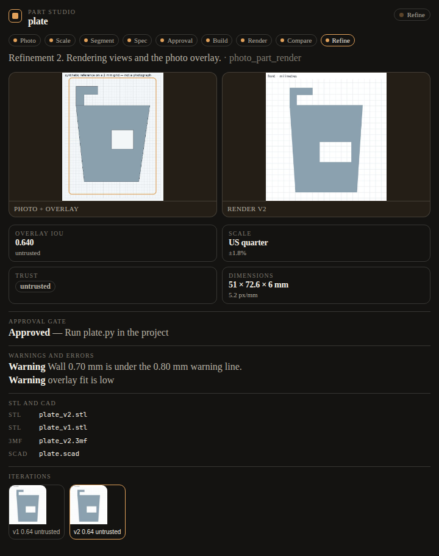
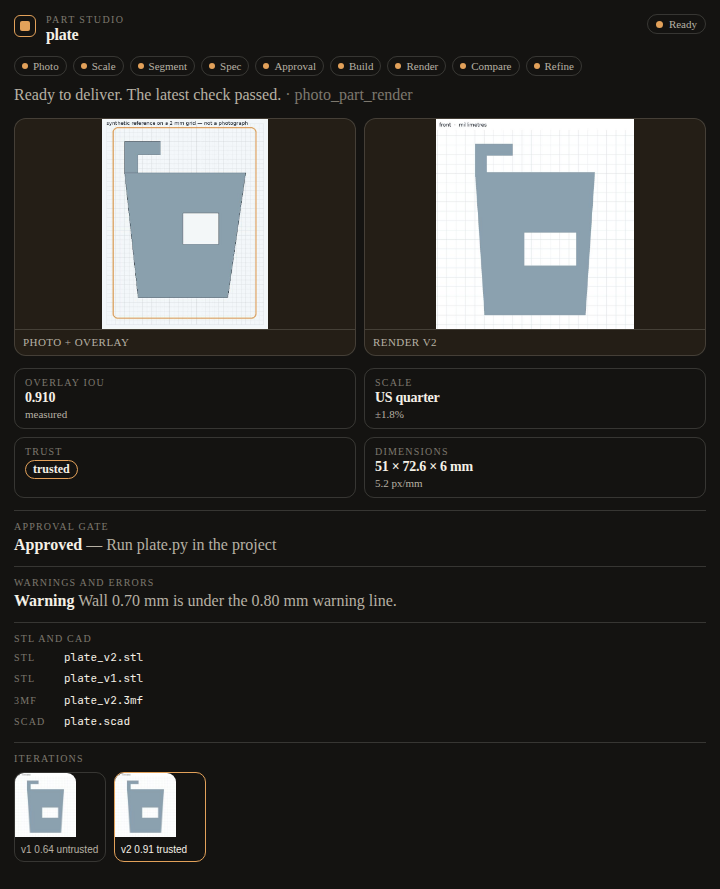

# Hermes desktop panes — what to copy

Research for the photo-to-part Part studio pane, November 2026. The pane API below is the native Hermes Desktop SDK (`hermes desktop`, `@hermes/plugin-sdk`). It is not the web dashboard tab SDK (`window.__HERMES_PLUGIN_SDK__` and `dashboard/manifest.json` tabs). The two do not share a frontend. They do share the gateway mount `/api/plugins/<name>/` when a package ships `dashboard/plugin_api.py`.

Sources:

- [Desktop Plugin SDK](https://hermes-agent.nousresearch.com/docs/developer-guide/desktop-plugin-sdk) (Hermes docs, current with 0.23)
- [skills/hermes-desktop-plugins/SKILL.md](https://github.com/NousResearch/hermes-agent/blob/main/skills/hermes-desktop-plugins/SKILL.md)
- Hermes 0.23.0 “Hearth” release notes (desktop panes, `ctx.files`, catalog UI)
- [mojomast/hermes-shortrizz](https://github.com/mojomast/hermes-shortrizz) v0.5.0 Studio pane (`desktop/plugin.js`, `dashboard/plugin_api.py`, PR that added the preview/iterate pane)
- [mojomast/hermes-stitchslop](https://github.com/mojomast/hermes-stitchslop) v0.2.1 and catalog PR [NousResearch/hermes-agent #151946](https://github.com/NousResearch/hermes-agent/pull/151946) (pane-only first pairing; the viewer is a loopback relay, not an iframe of the third-party site)
- [NousResearch/hermes-agent #145976](https://github.com/NousResearch/hermes-agent/pull/145976) (a manifest plus `desktop/plugin.js` is one package, and the agent half must actually be installed or `ctx.rest` 404s)

## Minimum version

The desktop half needs **Hermes ≥ 0.23.0**. That release is where unified packages copy `desktop/plugin.js` into `$HERMES_HOME/desktop-plugins/<name>/`, where `ctx.rest` / `ctx.socket` / `host.onEvent` are the supported data doors, and where `hermes_cli.plugin_events.broadcast_plugin_event` can push `plugin.<name>.<event>` to connected Desktop windows.

Do not set `requires_hermes: ">=0.23.0"` on a plugin whose tools must keep installing on older Hermes. photo-to-part’s doctor job is still Hermes v0.21.7 and checks the six tools. Extra `desktop/` and `dashboard/` files are ignored there. Shortrizz can require `>=0.23.0` because that plugin’s own contract moved to 0.23. This one must not.

Feature-detect inside `register`:

- If `ctx.register` is missing, return.
- Call `ctx.register` inside `try/catch` so an older desktop that loads the file but rejects `area: "panes"` does not take the plugin down.
- Call `broadcast_plugin_event` only when `hermes_cli.plugin_events` imports. Otherwise the call is a no-op.
- Poll. `ctx.socket` is a no-op on OAuth remotes, and a gateway with no Desktop window attached drops broadcasts. Shortrizz and the SDK both treat the socket or the event as an accelerator, not the only feed.

## How a package registers a pane

Layout that Hermes actually installs as one folder:

```
plugin/
  plugin.yaml              # agent half: tools, hooks. No pane fields.
  __init__.py              # register(ctx) — unchanged contract
  dashboard/manifest.json  # { "name": "<plugin>", "api": "plugin_api.py" }
  dashboard/plugin_api.py  # router = APIRouter(); routes under /api/plugins/<name>/
  desktop/plugin.js        # export default { id, name, register(ctx) }
```

`id` must match the plugin name and the desktop-plugins folder (`photo-to-part`). A root `plugin.js` wins over `desktop/plugin.js` and causes the whole package to be copied as the desktop half; keep the entry point in `desktop/plugin.js`.

Registration:

```javascript
ctx.register({
  id: "studio",
  title: "Part studio",
  area: "panes",
  order: 42,
  data: { placement: "right", width: "640px" },
  render: () => jsx(StudioPane, {})
})
```

`placement` is `main | left | right | top | bottom`. It stacks as a tab with panes of that role. `dock: { pane: "workspace", pos: "bottom" }` pins an edge instead; set `height` so it does not take half the window. `workspace` is the thread. Other built-in ids include `sessions`, `terminal`, `files`, `review`, `logs`.

Disk plugins are not compiled. JSX throws. Use `jsx` / `jsxs` from `react/jsx-runtime`. The only import specifiers that load are `@hermes/plugin-sdk`, `react`, and `react/jsx-runtime`. Anything else, including a relative `./pane.js` or an `https:` URL, fails the load. Inline the view, or generate one `plugin.js` (Shortrizz does this with `scripts/build_desktop.mjs`).

`plugin.yaml` does not grow a `pane:` block. The manifest that matters for the backend is `dashboard/manifest.json`: `name` (must match the plugin), `label`, `description`, `version`, `api`. A tab bundle is not required when the desktop half is the UI. Shortrizz ships exactly that: API manifest, no dashboard tab.

Two enable switches stay separate. The Python half is `plugins.enabled` in `config.yaml`. The desktop half is the Capabilities → Plugins toggle. Enabling the pane does not import Python. `plugin_api.py` is imported only when the plugin is on the allow-list. `ctx.rest` then 404s until both are on and the gateway has restarted (routes mount at startup). The pane should say so, not crash. Dropping files into `~/.hermes/plugins` does not enable either half.

`defaultEnabled: true` matches Shortrizz so a host that honors the flag shows the pane once the user enables the package. The SDK also says unified packages inventory the desktop half as opt-in until the user toggles it. Don’t fight a user who turned the pane off. Closing the only pane a plugin contributes disables that plugin; Reset layout brings it back.

## How the pane gets data

Prefer this order:

1. **Write a small JSON record from the tool process** as the source of truth. Shortrizz jobs write `progress.json` in the run folder and the pane reads it through `plugin_api.py`. photo-to-part writes `<project>/.photopart/pane.json` plus an index at `$HERMES_HOME/.photopart/pane-index.json` so the gateway can list projects it did not choose. Do not add pane fields to tool schemas. The model does not need them, and they bloat every call.
2. **Serve that record on `ctx.rest`.** Paths are namespace-relative (`ctx.rest("/runs")` → `/api/plugins/photo-to-part/runs`). `ctx.rest` rejects `..` and cannot call another plugin or a core route. Return `{ok:false, error, fix}` in the body, the way Shortrizz does, so the pane can show a next step instead of an HTTP stack.
3. **Push `broadcast_plugin_event(plugin_id, event, payload)`** from the tool or the API when the import exists. The wire name is `plugin.<plugin_id>.<event>` (`plugin.photo-to-part.run.updated`). `plugin_id` is `[a-z0-9_-]{1,64}` with no dots. `event` is a bare dotted name. The payload should be a small dict (id, stage, status), not images. Delivery is fire-and-forget. It reaches Desktop only when the caller is in the process Desktop is attached to (gateway tools, hooks, `plugin_api.py`). `hermes chat`, cron, and `hermes plugins validate` have no Desktop client; the call is a logged no-op.
4. **Poll on `ctx.setInterval` every couple of seconds.** The SDK says not to poll `host.request` faster than that. Use `ctx.setInterval`, not `window.setInterval`: bare timers survive hot reload and disable. Subscribe with `host.onEvent` inside `register` and drop the listener on the disposer it returns. Keep the poll even when the event is wired.
5. **`ctx.socket("/events")` is optional.** It auto-reconnects, except on OAuth remotes where it resolves to a no-op. A plugin that only works with the socket will look frozen for those users.

Images of files that live on the backend belong on a plugin route, not `ctx.files`. `ctx.files` is the Desktop machine: the plugin’s own data folder, plus folders the user granted. Backend paths (the STL the tool just wrote) are a different computer when the gateway is remote. Return a data URL or bytes from `plugin_api.py`, and cap the size. Shortrizz’s `/media` route confines every path to the run root before it reads.

Don’t embed a third-party origin in a raw frame. The SDK’s `SandboxedFrame` is the guest posture (opaque origin, `allow-scripts`, no `allow-same-origin`). Stitchslop cannot iframe stitchslop.com (`frame-ancestors 'none'`), so it serves its own loopback viewer and the pane embeds that. photo-to-part has no need for a second server: the gateway mount is enough, and a second listener is another thing to disclose and bind.

## Security and sandbox

A desktop plugin is evaluated as ESM in the renderer. Isolation is error isolation, not a sandbox. It can see `host.request`, storage, and `window.hermesDesktop`. Catalog trust is admission of a pinned commit, plus an import allowlist and a desktop-surface lint. Neither is a boundary.

What reviewers have actually asked for, from the Shortrizz and Stitchslop catalog PRs and the SDK:

- Disclose files written, processes started, and network. “No credentials, no self-update, no extra upload” belongs in the README and SECURITY notes.
- Don’t read the Hermes credential store or a dotenv file from the pane or its API.
- Don’t add tools so the pane can do the work. Shortrizz kept six tools when Studio landed. Stitchslop’s first pairing is pane/hand only: the connect tool refuses a model-supplied token.
- Confine every file read. Resolve, reject `..` and absolute paths, then `relative_to` the project. Refuse symlink escapes the same way (`resolve` then the relative check).
- Don’t let the pane become a back door around an existing guard. photo-to-part must not serve `evals/` or `tests/regression`, and it must not serve a file that contains the eval canary, even if that file sits in a project directory.
- Style with `var(--ui-text-secondary)`, `--ui-text-tertiary`, `--ui-text-quaternary`, `--ui-stroke-secondary`, `--ui-accent`. No hex colors in the plugin. The pane sits on the editor background; don’t paint your own page background.
- Use `ctx.files` if you ever touch the Desktop disk. Don’t call the raw `window.hermesDesktop` file bridge; catalog review asks for the granted-folder door.
- Timers, listeners, and style tags go through `ctx.setInterval` / `ctx.addEventListener` / `ctx.onDispose`. Module scope is not reset on hot reload.
- Top-level `await` that never settles fails the load after 10 seconds. Wait inside `register` or the pane.

`plugin_api.py` runs inside the gateway process. It can import Hermes, which is why the missing-import guard matters on 0.21.7. Keep the FastAPI module thin and put the behavior in the plugin package so unit tests don’t need the gateway.

## What “good” looks like in the pane

Shortrizz Studio is the bar for a run you watch while it happens: a list of runs, the current stage in words, a progress meter, the thing the user cares about (the storyboard) before the expensive step, and controls that write a versioned file rather than a log. Stitchslop’s pane is the bar for “show the real surface”: one capture path, no flicker, input that goes through the same choke point as the agent, and a viewer that does not depend on CORS against the upstream site.

For a fabrication run, that means a stage rail (photo, scale, segment, spec, approval, build, render, compare, refine), the photo with the overlay next to the latest render, the iteration strip, and the few numbers that decide whether to ship (IoU, scale source, confidence, trust, dimensions). Warnings and the approval gate are status, not a transcript. Output paths are copyable text. An empty pane should say what to do in chat, because the pane cannot start the protected build by itself.

The agent half must stay boring. Same six tools, same hook names, same approval `rule_key`, same eval block. Progress helpers swallow exceptions. Help and describe must not write a project file. The install directory and the source checkout are not projects.

Headless captures of this pane, driven by the real progress record and the same DOM the desktop bundle inlines:




